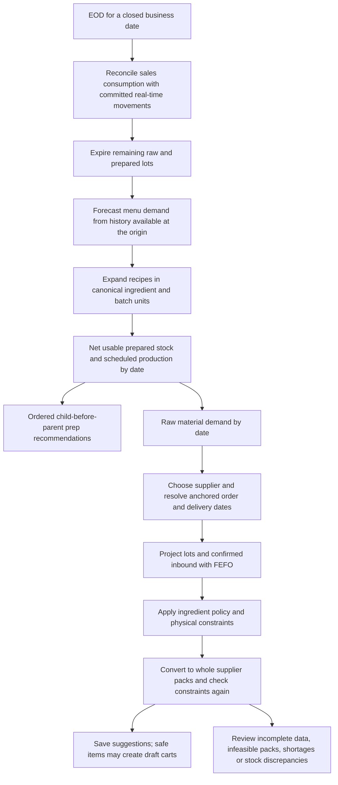

# How PrepIQ plans food and purchases

The purchase engine does not predict sales itself. Forecasting predicts menu quantities. A shared recipe expander converts those quantities into prepared output and direct raw use. The material planner then subtracts usable prepared stock and dated scheduled production before calculating the raw inputs still needed. Reordering decides when and how much of each raw ingredient to buy.

## Follow the active path

`EODService` owns stage persistence and retries. `ForecastingEngine.run_forecasting_pipeline` owns the frozen forecast snapshot; Basic uses the same pipeline. `RecipeUsageExpander` owns typed recipe references and conversions. `PrepPlanningService` owns net production/material demand. `ReorderContextBuilder`, `ReorderPolicyMathHelper`, and `pack_order` respectively own context, quantity rules, and the physical purchase contract. `InventoryConsumption` owns actual lot allocation.

Sales consume a prepared batch, without consuming that batch's raw inputs again. Completing production consumes its direct raw or already-produced child inputs and creates one output lot. Receipts add a physical quantity once. Waste and expiry consume remaining lot balances; prepared waste has a batch identity and nullable raw ingredient identity. Quantities are stored to six decimal places; money keeps its monetary precision.

## Dates, observations and stock

The forecast origin is the closed business date. EOD purchasing evaluates the next business date, and predictions start after the origin. An overnight sale belongs to its opening business day. Offset-bearing CSV timestamps are instants and are converted using the restaurant timezone; naive daily CSV dates retain their selected date. Legacy null business dates retain the old timestamp-date behavior until an operator reconciles/backfills them.

Expiry is the last usable date. FEFO consumes earlier expiry first; EOD writes off that day's remaining expired quantity after reconciling sales. A summary/lot discrepancy requires reconciliation. Known expired or unavailable lots never become usable through a fallback to the summary. Raw stock without any lot history is an explicitly degraded legacy source.

Only pending, confirmed, undelivered PO quantities count as inbound, net of receipts. Carts are proposed purchases. Cancelled/delivered POs are excluded. Unknown or overdue ETAs require review. Inbound that arrives after a shortage cannot cover earlier service, even if the aggregate inventory position looks sufficient.

A sale row does not prove an entire day was imported. Restaurant settings declare complete imported windows and explicit closed/missing/stockout/unavailable dates. Unknown/censored dates make forecast-driven actions provisional. Completed observations are used for scoring; future dates, missing imports, and forecasts issued after their outcomes are excluded.

Inventory statistics use canonical daily totals, rather than individual movement timestamps. Sufficient valid movement days describe actual raw consumption timing, including production inputs. The fallback describes **sales-equivalent** raw consumption using recipes; it has different timing from actual production. Waste, spoilage, receipts and adjustments are excluded from demand. Declared complete zero-use days count; unverified zero filling is labelled.

## The four current quantity policies

Let `L` be effective lead time including the wait until the next allowed order and delivery. Let `R` be review days. For perishables, the post-arrival window is limited by shelf life. Let `IP` be usable stock plus confirmed inbound, with the assumed zero backorder quantity disclosed. Pre-arrival lost demand is separated from the new delivery's requirements. Dated supply is projected through demand before computing constraints.

| Policy | Quantity rule before shared constraints | Configuration that affects it |
| --- | --- | --- |
| Stable stocked | Safety stock `S = z × daily_sigma × sqrt(L)`. Trigger when `IP <= lead_demand + S`; target is protection demand plus `S`. | `service_level_z`, valid demand history, lead/cadence/review, maximum stock |
| Fresh perishable | Cover demand from arrival through the usable window, with reserve up to one average day. Cap freshness allowance at `shelf_demand × (1 + max(0.10 − spoilage_rate, 0))`. | Shelf life, cadence/review, supplier spoilage rate, stock/expiry, maximum stock |
| Recipe dependent | Net protection demand plus a dependency guard: average/peak for menu inputs, peak for batch or mixed inputs. | Actual net material plan, dependency links, cadence/review, maximum stock |
| Intermittent low turn | First positive post-arrival forecast quantity, plus a bounded sparse guard for repeated positive rows. | Forecast values and spacing, cadence/review, MOQ, maximum stock |

Expected daily TSB values are probabilities times event sizes; their positive rows are not known future event dates. The intermittent policy remains a heuristic. ABC is explanatory classification here; it is not an extra quantity multiplier. Model confidence is a forecast diagnostic, not a fill-rate guarantee. `z` changes stable stock's safety stock; it does not tune all four policies.

The shared target cap preserves the policy reserve, then applies maximum-stock constraints. MOQ applies only when there is a positive purchase requirement. The final result is converted to the supplier unit and rounded to whole physical packs. If packs or MOQ exceed a stock/shelf-life cap, the suggestion requires review and is excluded from automatic cart creation. Operators can still review the physical alternative; a small fractional recommendation is not a deliverable pack.

## Worked examples

**Units and prep:** Eight servings need 250 g of salsa each: 2 kg of prepared salsa. A salsa batch yields 5 kg and needs 2.5 kg of tomato. With 1 kg usable salsa and no scheduled output, additional production is 1 kg, or 0.2 batches, requiring 0.5 kg tomato. Selling the salsa consumes its output lot; making it consumes tomato. Scheduled output on an earlier day covers later demand only while it remains usable. Fractional batches are the selected planning policy; actual positive batch counts determine recorded production. Operator-entered whole batches can create surplus, which is shown for review.

**Fresh delivery:** Order decision Monday, lead two days, shelf life two usable days, no stock. Demand is 10 kg Wednesday and 10 kg Thursday. Post-arrival demand is 20 kg. The one-day reserve is 10 kg, while the default freshness allowance caps the purchase at 22 kg. A 1 kg pack permits 22 packs; a 5 kg pack implies 25 kg and requires review. Monday/Tuesday missed demand is not added to Wednesday's purchase.

**Stable stock:** Daily mean 10 kg, sigma 2 kg, `L=2`, `R=3`, `z=1.28`, `IP=5 kg`. Safety stock is approximately 3.620386 kg. The trigger is 23.620386 kg and target 53.620386 kg, giving 48.620386 kg before pack constraints. A 10 kg pack expands this to 50 kg. If the effective cap is 48.620386 kg, it needs review. This illustrates why pack feasibility must be checked after rounding.

**Late inbound:** Ten kg are needed Tuesday. Ten kg confirmed inbound arrive Thursday. Aggregate position is ten, but the Tuesday shortage remains. The engine flags timing review; changing ETA, expediting or cancelling/replacing that supply is an operator decision.

## Alternative algorithm and measured limits

The offline harness compares the four corrected quantity heuristics, a legacy reference, periodic and seasonal-periodic order-up-to, and bounded expiry-aware integer-pack candidate search. The corrected comparisons are reference arithmetic under stated scenario assumptions; they do not reproduce every repository/supplier/prep interaction. Actual production feasibility is checked by the material-plan and production regressions. The replay assumes supplied values are complete uncensored demand, deterministic delivery and unconstrained prep capacity.

Periodic review considers uncertainty across lead plus review time. That is the next policy comparison to discuss, especially for suppliers visited on fixed days. See [MIT's inventory model summary](https://ocw.mit.edu/courses/15-763j-manufacturing-system-and-supply-chain-design-spring-2005/e1800430fdccaf618b22bd551fc00fac_summary.pdf). The experiment scores feasible packs against purchase, waste and shortage costs under past realized forecast-error scenarios. No scenario sees future demand at its decision origin. Multi-step scoring follows [rolling-origin evaluation](https://otexts.com/fpp3/tscv.html).

The recorded run includes actual calendar H2O GBM fits alongside mean, weekday and TSB forecasts. It reports bias, MAE, WAPE, seasonal MASE and empirical 80% horizon interval coverage. MASE is unavailable when seasonal scale is zero. Constant histories use an explicit GBM fallback. Small synthetic samples do not establish calibrated customer uncertainty or an algorithm winner.

The most useful finding is **pack infeasibility**: on the steady short-life synthetic case, a 22 kg fresh target with 5 kg packs repeatedly fails the cap review gate. Candidate search can choose 20 kg and cover service without that rounding conflict. On the large-pack/small-demand case, even the candidate cannot meet demand within the shelf-life cap: supplier pack size or a manual availability/waste tradeoff must change. This deserves discussion before changing production policy.

See [benchmark results](reorder-benchmark-results.json) and [benchmark summary](reorder-benchmark-summary.md). The candidate remains offline; there is no hidden production algorithm switch. Run representative held-out restaurant histories and agree acceptable fill-rate, waste and cash outcomes before adoption.
